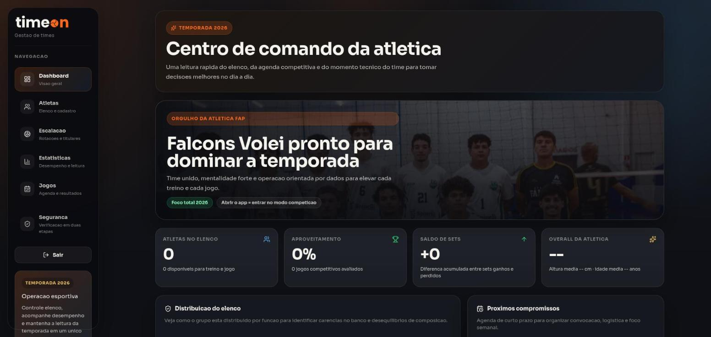

<!-- markdownlint-disable MD033 -->
<div align="center">

<picture>
  <source media="(prefers-color-scheme: dark)" srcset="docs/images/timeon-logo-dark.svg">
  
</picture>

**Gestão de times: elenco, escalação, jogos e estatísticas.**
Hoje com o Falcons Vôlei (Atlética FAP); vôlei, futsal, futebol e basquete em evolução.

[](https://timeon-painel.vercel.app)




</div>

## Sobre

O **TimeOn** é uma plataforma profissional de gestão esportiva, em tema escuro. O primeiro time é o Falcons Vôlei, da Atlética FAP; a base está sendo preparada para vários times e esportes. Centraliza a leitura do elenco, a agenda competitiva e o desempenho individual para apoiar as decisões da comissão técnica em treinos e campeonatos. O sistema guarda dados pessoais dos atletas, por isso o acesso é restrito a usuários autenticados e todas as escritas passam por uma API própria com validação.

## Links

| | |
|---|---|
| Sistema publicado | https://timeon-painel.vercel.app |
| Repositório | https://github.com/dutrathiagodev/timeon-gestor-de-times |
| LinkedIn | [dutrathiagodev](https://www.linkedin.com/in/dutrathiagodev/) |
| GitHub | [dutrathiagodev](https://github.com/dutrathiagodev) |

## O que tem no sistema

- **Dashboard** com atletas no elenco, aproveitamento, saldo de sets, overall da atlética, distribuição por posição, próximos compromissos e últimos resultados
- **Atletas**, com cadastro completo, disponibilidade, posição, camisa, dados físicos e foto
- **Escalação**, com montagem do sexteto, visualização da quadra e rotações
- **Estatísticas**, com fundamentos por atleta (passe, saque, ataque, bloqueio), overall individual e rankings
- **Jogos**, em calendário mensal com campeonatos, amistosos, treinos e reuniões, além de placar e resultado
- **Login** com Supabase Auth: sem sessão, todas as rotas redirecionam para `/login`
- Layout responsivo (desktop, tablet e celular)

## Segurança

- Somente usuários autenticados acessam; o cadastro público fica desativado e os usuários são criados pela administração
- O navegador nunca fala direto com o banco: leituras no servidor e escritas pela API
- A API valida origem (CSRF), sessão, tabelas e colunas permitidas
- RLS ligado em todas as tabelas, sem acesso anônimo
- Upload de foto limitado a JPG, PNG ou WEBP de até 2 MB
- Headers de segurança (CSP, X-Frame-Options, nosniff) aplicados em `src/proxy.ts`

Regras completas e checklist de PR em [`docs/architecture/feature.security.md`](docs/architecture/feature.security.md).

## API

| Rota | Método | Uso |
|---|---|---|
| `/api/players`, `/api/games`, `/api/stats` | `POST` | cria (stats faz upsert por jogo e atleta) |
| `/api/players/:id`, `/api/games/:id`, `/api/stats/:id` | `PATCH`, `DELETE` | edita e remove |
| `/api/photos` | `POST` | envia foto de atleta |
| `/api/auth/login`, `/api/auth/logout` | `POST` | sessão via Supabase Auth |

Para criar um recurso novo, registre a tabela e as colunas permitidas em `src/lib/api.ts` (`resources`).

## Identidade visual

Marca, cores e tipografia (Sora) em [`docs/architecture/feature.design.md`](docs/architecture/feature.design.md). A logo é o componente `BrandLogo`; o "O" é a bola do esporte.

## Tecnologias

- [Next.js 16](https://nextjs.org) (App Router, Server Components e Route Handlers) e [React 19](https://react.dev)
- [TypeScript](https://www.typescriptlang.org)
- [Tailwind CSS 4](https://tailwindcss.com)
- [Supabase](https://supabase.com) (PostgreSQL com RLS, Auth e Storage)
- [Vitest](https://vitest.dev) e ESLint
- GitHub Actions para o CI
- [Vercel](https://vercel.com) para o deploy

## Como rodar

Pré-requisito: Node.js 20 ou superior.

1. Crie o `.env.local` com `NEXT_PUBLIC_SUPABASE_URL` e `NEXT_PUBLIC_SUPABASE_PUBLISHABLE_KEY`.
2. Aplique as migrations de `supabase/migrations` (a última fecha o acesso anônimo ao banco).
3. No Supabase, em Authentication, desative o cadastro público e crie os usuários do time.

```bash
npm install
npm run dev     # desenvolvimento em http://localhost:3000
npm run lint    # lint
npm test        # testes
npm run build   # build de produção
npm run start   # serve o build
```

## Estrutura

```text
src/
  app/                  layout, páginas (uma pasta por rota), API (api/), estilos globais
  components/
    layout/             sidebar e top-bar
    sections/<secao>/   uma pasta por tela (dashboard, players, games, lineup, statistics, login)
  lib/                  regras de vôlei, helpers da API e clientes do Supabase
  proxy.ts              sessão, redirecionamento para login e headers de segurança
public/                 logo e imagens
supabase/
  migrations/           esquema do banco e policies (RLS)
docs/
  architecture/         regras de arquitetura e segurança
  images/               imagens usadas na documentação (print da tela principal)
```

Cada página em `src/app` busca os dados no servidor e entrega a uma seção. As regras completas estão em [`docs/architecture`](docs/architecture).

## Publicação

O deploy é feito na Vercel a partir do GitHub, que detecta o Next.js e roda `npm run build`. As variáveis `NEXT_PUBLIC_SUPABASE_URL` e `NEXT_PUBLIC_SUPABASE_PUBLISHABLE_KEY` ficam configuradas no painel da Vercel, nunca no repositório. A cada pull request o CI roda lint, testes e build.

## Contato

- 📧 [thiagodutrasap@gmail.com](mailto:thiagodutrasap@gmail.com)
- 💼 [LinkedIn](https://www.linkedin.com/in/dutrathiagodev/)
- 🐙 [GitHub](https://github.com/dutrathiagodev)
